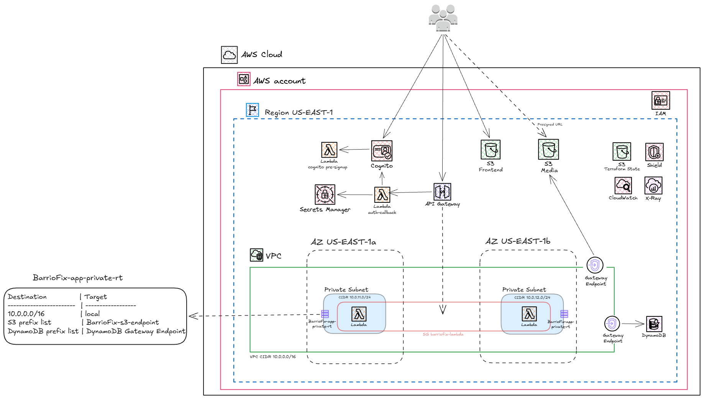

# Arquitectura de BarrioFix

Todo corre sobre servicios administrados de AWS. Estos son los que usamos y para qué:

- AWS Lambda: el backend. Hay una función por dominio de la API y dos más que se disparan por eventos, con un layer de código común y el layer público de Powertools.
- Amazon API Gateway (HTTP API): la entrada HTTPS a las Lambdas. Valida el token de Cognito y aplica throttling.
- Amazon DynamoDB: los datos de la app, en una sola tabla con tres índices secundarios.
- Amazon Cognito: registro y login con la Hosted UI, y emisión de los tokens.
- AWS Secrets Manager: guarda el client secret de Cognito.
- Amazon S3: el sitio estático del frontend, las fotos de las solicitudes y el state de Terraform.
- Amazon VPC: subredes privadas para las Lambdas, con Gateway Endpoints a S3 y DynamoDB y un security group.
- AWS IAM: el LabRole del lab, que es el rol de ejecución de todas las Lambdas.
- Amazon CloudWatch Logs: los logs de cada Lambda, en log groups que crea Terraform.
- AWS X-Ray: el tracing de las Lambdas.
- AWS Shield Standard: protección contra ataques de red, que viene activa por defecto en API Gateway y S3.

Fuera de AWS, el frontend usa la API de Google Maps para mostrar la ubicación de cada solicitud.

## Cómo se comunican

El frontend es un sitio estático en S3. Cuando arranca lee un config.json que sube Terraform
con la URL de la API y los datos de Cognito, así el mismo build sirve para cualquier cuenta.

Para entrar, el navegador redirige a la Hosted UI de Cognito. Después del login, Cognito vuelve
a /callback en API Gateway, que invoca a la Lambda auth-callback. Esa función cambia el código
de autorización por los tokens (para eso se autentica contra Cognito con el client secret que
lee de Secrets Manager) y redirige al frontend con los tokens. La Hosted UI solo acepta un
callback con HTTPS y el sitio en S3 es HTTP, por eso el callback está en API Gateway y no en el
sitio.

Con el token, el navegador ya puede llamar a la API. API Gateway valida el token contra Cognito
antes de invocar cualquier Lambda, aplica throttling y manda cada ruta a la Lambda de su dominio:
catálogos, usuarios, solicitudes, flujo, calificaciones o fotos. Cognito solo dice quién es el
usuario. Si es cliente o profesional se guarda en DynamoDB, y por eso el registro tiene dos
pasos: la cuenta se crea en la Hosted UI y el perfil (nombre, rol, categorías) se completa con
una llamada a la API la primera vez que el usuario entra.

Las fotos no pasan por la API. El backend firma una URL y el navegador sube o baja el archivo
directo a S3. Antes de subirla, el navegador achica y comprime la foto, así que llega con unos
cientos de KB; el backend igual acepta hasta 50 MB por foto, como resguardo. El mapa de cada solicitud lo dibuja el navegador con Google Maps, usando la key que
Terraform pone en el config.json; si no hay key, se muestra solo la dirección.

Hay dos Lambdas que no se llaman por HTTP sino que las dispara otro servicio. Cognito invoca a
pre-signup en cada alta, y la usamos para confirmar la cuenta sin mandar un mail de
verificación, que en una demo solo molesta. S3 invoca a foto-subida cuando termina de llegar una
foto, y esa función la registra en su solicitud. Si S3 reintenta el evento, la foto no se
duplica.

## Datos

Usamos una sola tabla, con PK y SK, y tres índices secundarios: uno para las solicitudes de un
cliente, otro para las asignadas a un profesional y otro para los trabajos pendientes de cada
categoría. Los dos últimos son sparse, o sea que un ítem solo aparece en el índice mientras
tiene ese atributo; una solicitud deja de estar en pendientes apenas alguien la toma.

El estado de cada solicitud se guarda en el mismo ítem y se actualiza con transacciones. Para
que dos profesionales no tomen el mismo trabajo no usamos bloqueos: la escritura es condicional
sobre el estado, y si otro llegó primero, falla.

Los catálogos, los usuarios de demo y un set de solicitudes en distintos estados los carga
Terraform como seed.

## Red

Las Lambdas que tocan datos están en subredes privadas sin NAT ni Internet Gateway. Llegan a
DynamoDB y a S3 por Gateway Endpoints, que además no cuestan nada, y las policies de esos
endpoints solo permiten la tabla y el bucket del proyecto. Si alguna función quedara
comprometida, no tendría a dónde sacar los datos. La única excepción es auth-callback, que corre
fuera de la VPC porque necesita llegar a Cognito por internet, pero no toca ningún dato.

En el TP2 teníamos RDS y un nivel de subredes solo para la base. DynamoDB es un servicio
regional que no vive dentro de la VPC, así que ese nivel ya no hace falta y quedó un solo nivel
de subredes privadas.

## Seguridad

En el Learner Lab no se pueden crear roles, y todas las Lambdas usan LabRole, que tiene permisos
amplios. Entonces el mínimo privilegio lo aplicamos por otro lado. A nivel red, con las policies
de los endpoints. A nivel recursos, con la bucket policy del front, una resource policy opcional
en DynamoDB que solo acepta tráfico que venga del endpoint de la VPC, y los permisos de
invocación de cada Lambda, que dicen exactamente qué servicio puede llamarla.

Las URLs firmadas para las fotos tienen condiciones: tamaño máximo, solo imágenes y la key
exacta. Los endpoints que no pueden pedir login, el callback y los catálogos, están cubiertos
por el throttling de API Gateway, y auth-callback además tiene concurrencia reservada, para que
un flood no se coma el límite de concurrencia de toda la cuenta.

No pusimos WAF. Solo se puede asociar a una REST API o a CloudFront, no a una HTTP API, y
CloudFront no está en el lab. Para usarlo tendríamos que pasar la API a REST API, y en una API
sin SQL ni HTML renderizado no vimos que valga la pena. Lo dejamos como mejora futura.

## Lo que marca el análisis estático

El tfsec del template y el code scanning de GitHub marcan algunas cosas que dejamos así a
propósito, y cada una tiene su comentario en el código.

El bucket del frontend es público porque sirve el sitio, pero la policy solo permite leer: no
se puede escribir ni listar. La contra es que no hay HTTPS directo ni CDN adelante. Tampoco
tiene versionado, porque el sitio se vuelve a subir entero en cada deploy y las versiones viejas
del build no sirven para nada.

Para cifrar en reposo usamos las llaves que administra AWS, no llaves propias de KMS, en
DynamoDB, Secrets Manager, S3 y CloudWatch. En el lab no creamos llaves de KMS, por costo y
porque LabRole no está pensado para eso. Tampoco activamos point in time recovery en DynamoDB ni
los access logs de API Gateway: para esta entrega no justifican el costo, y con los logs de las
Lambdas alcanza. Las Lambdas sí tienen el tracing de X-Ray activado.

Los detalles de Terraform (módulos, funciones, meta-argumentos y state) están en el README.
